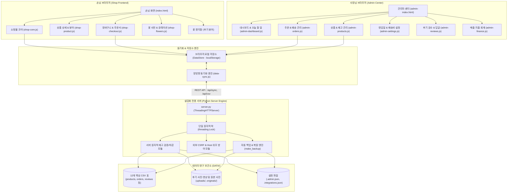
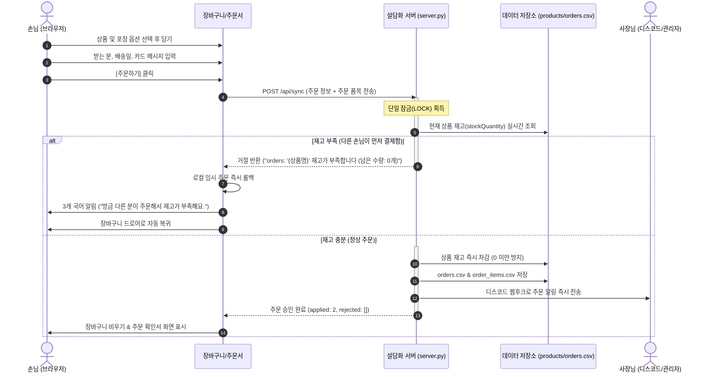
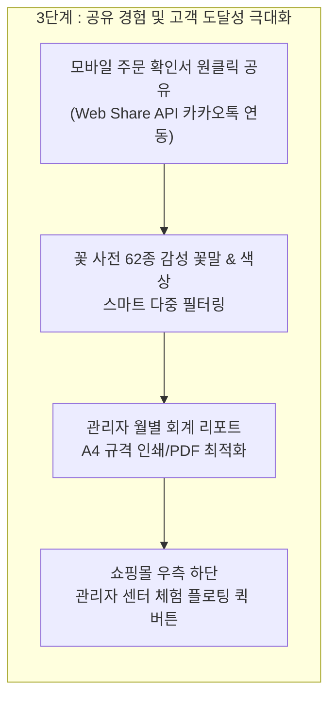

# 설담화 (說談花)

> **"꽃에 이야기를 담고, 마음에 온기를 전합니다."**  
> 한국 전통 한옥의 단아함과 정갈함을 현대적으로 재해석한 프리미엄 감성 꽃 셀렉트샵 **설담화(說談花)** 풀스택 웹 플랫폼입니다.  
> 손님을 위한 온라인 쇼핑몰과 1인 플로리스트 사장님을 위한 직관적인 관리자 센터로 구성되어 있습니다.

---

## 🌐 실시간 데모 (Live Demo)
- 🌸 **손님 쇼핑몰 바로가기**: [https://sh11025.github.io/SeolDamHwa/](https://sh11025.github.io/SeolDamHwa/)
- 🛠️ **사장님 관리자 센터 바로가기**: [https://sh11025.github.io/SeolDamHwa/admin-index.html](https://sh11025.github.io/SeolDamHwa/admin-index.html)  
  *(쇼핑몰 메인 화면 맨 아래 푸터 저작권 문구 옆 `[관리자]` 글씨를 누르셔도 바로 열립니다)*

---

# Ⅰ. 서비스 기획서 (Product Specification)

## 1. 브랜드 개요 및 핵심 철학

- **브랜드명**: 설담화 (說談花) — *말씀 설(說), 말씀 담(談), 꽃 화(花)*
- **슬로건**: "꽃에 이야기를 담고, 마음에 온기를 전합니다."
- **핵심 컨셉**: 한국 전통 한옥의 단아함과 정갈함을 현대적으로 재해석한 프리미엄 감성 꽃집
- **시각적 정체성 (Visual Identity)**:
  - **한지 질감 (韓紙)**: 따뜻하고 은은한 한지 배경 (`#FBF9F5`, 닥나무 한지 텍스처)
  - **먹빛 붓터치 (墨)**: 묵직하고 단아한 먹빛 헤드라인 및 구분선 (`#1A1A1A`)
  - **자개(螺鈿) & 인주(印朱)**: 오색 은은한 자개 버튼 효과 및 선명한 설담화 붉은 인장 도장 낙관
  - **정통 포장**: 기본 단아 한지 포장 및 전통 실크 본견 보자기 & 노리개 포장

---

## 2. 타겟 고객 및 사용자 페르소나

1. **마음을 전하는 선물 고객 (20~40대 남녀)**
   - 부모님 생신/환갑, 연인과의 기념일, 승진/영전, 병문안/위로 등 특별한 상황에서 품격 있는 꽃 선물을 찾는 손님
   - "꽃만 덩그러니 가는 것이 아니라, 내 진심 어린 사연과 정성이 함께 전달되길 원하는 고객"
2. **외국인 및 전통 문화 애호 고객**
   - 보자기 포장, 노리개, 한국 꽃말의 정취를 경험하고 선물하고자 하는 고객 (한국어/영어/일본어 3개 국어 완벽 지원)
3. **1인 매장 전문 플로리스트 (사장님)**
   - 꽃 손질, 제작, 포장, 배송 준비로 손이 쉴 틈 없는 바쁜 1인 꽃집 사장님
   - 복잡한 ERP 대신, 직관적이고 군더더기 없는 모바일/PC 통합 운영 관리 필요

---

# Ⅱ. 시스템 아키텍처 및 핵심 플로우

## 1. 시스템 아키텍처 (System Architecture)



---

## 2. 핵심 비즈니스 플로우: 원자적 재고 처리 흐름



---

# Ⅲ. 기능별 구현 현황 및 진행도 (Implementation Progress)

| 대분류 | 세부 기능명 | 구현 상태 | 완성도 | 핵심 특징 및 구현 상세 |
| :--- | :--- | :---: | :---: | :--- |
| **쇼핑몰 (손님)** | **홈 브랜드 뷰 & 큐레이션** | ✅ 완료 | 100% | 전통 한옥 모티브 레이아웃, 꽃 편지 슬라이더, 맞춤 담화 큐레이션 띠 연동 |
| **쇼핑몰 (손님)** | **상품 탐색 & 필터링** | ✅ 완료 | 100% | 7대 카테고리(꽃다발/꽃바구니/화병/드라이/공간/화분/굿즈), 제철 꽃 태그 |
| **쇼핑몰 (손님)** | **상품 상세(PDP) & 포장 선택** | ✅ 완료 | 100% | 한지/보자기 포장 선택지, 사이즈 선택, 꽃말 및 화병 관리법 접기 연동 |
| **쇼핑몰 (손님)** | **12폭 병풍 꽃 사전** | ✅ 완료 | 100% | 24절기/사계절 색상 기반 꽃 사전(62종), 제철 계산기, 상품 바로가기 |
| **쇼핑몰 (손님)** | **정갈한 체크아웃** | ✅ 완료 | 100% | 퀵/택배/픽업 선택, 휴무일/마감일 제외 14일 달력, 안심 카드 메시지 입력 |
| **쇼핑몰 (손님)** | **주문 확인서 & 이미지 저장** | ✅ 완료 | 100% | 한지풍 주문 확인서 캔버스 이미지 생성/저장, 주문번호 원클릭 복사 |
| **쇼핑몰 (손님)** | **꽃 편지함 (포토 후기)** | ✅ 완료 | 100% | 배송 완료 주문 손님 작성, 사진 3장·영상 1개 업로드, 7대 사연 선택 |
| **쇼핑몰 (손님)** | **3개 국어 다국어(i18n)** | ✅ 완료 | 100% | 한국어(KO), 영어(EN), 일본어(JA) 실시간 언어 변환 및 주문서 보존 |
| **관리자 (사장님)** | **대시보드 & 오늘 할 일** | ✅ 완료 | 100% | 오늘 배송/픽업 건수, 꽃 사입량 자동 계산, 미답변 상담 및 미승인 후기 배지 |
| **관리자 (사장님)** | **주문 & 배송 통합 관리** | ✅ 완료 | 100% | 5단계 주문 상태 변경, 운송장 번호 입력, 택배 배송조회 연동, 후기 요청 문자 |
| **관리자 (사장님)** | **상품 & 실시간 재고 관리** | ✅ 완료 | 100% | 상품 등록/수정/숨김, 재고 수량 편집, 사이즈 옵션 구성, 추천 태그 지정 |
| **관리자 (사장님)** | **꽃 편지(후기) 승인 & 답글** | ✅ 완료 | 100% | 사장님 승인제(`pending`→`approved`), 사장님 답글 작성, 불량 후기 즉시 삭제 |
| **관리자 (사장님)** | **매장 일정 & 배송 정책 설정** | ✅ 완료 | 100% | 영업시간, 정기휴일, 법정 공휴일/임시 휴무일 제어, 퀵/택배 배송비 규칙 |
| **관리자 (사장님)** | **포장 옵션 커스텀 관리** | ✅ 완료 | 100% | 보자기/한지 포장 추가·수정·순서변경, 실시간 쇼핑몰/주문서/라벨 가격 연동 |
| **관리자 (사장님)** | **재무 회계 & 엑셀 다운로드** | ✅ 완료 | 100% | 월별 매출·지출·순마진 Chart.js 그래프, 회계용 개인정보 제외 .xlsx 다운로드 |
| **관리자 (사장님)** | **보안 및 개인정보 관리** | ✅ 완료 | 100% | 5년 경과 주문 식별정보 영구 파기(익명화), 1년 경과 상담·재입고 정리 |
| **인프라 & 서버** | **서버 사이드 재고 제어** | ✅ 완료 | 100% | 손님 기기 직접 재고 조작 차단, 동시 주문 1건 승인 및 음수 재고 방지 |
| **인프라 & 서버** | **보안 & CSRF 방어** | ✅ 완료 | 100% | 관리자 다운로드 교차출처 차단(403), Host 헤더 DNS 재바인딩 방어, PBKDF2 암호화 |
| **인프라 & 서버** | **CSV 데이터베이스 백업** | ✅ 완료 | 100% | 10분 주기/최신 40개 자동 백업, 원본 사진 Supabase Storage 비공개 버킷 백업 |

---

## ✨ 핵심 구현 기능 하이라이트 (Key Features Highlight)

설담화 플랫폼에 실제 구현되어 작동 중인 10대 핵심 차별화 기능입니다.

### 🌸 손님 쇼핑몰 감성·편의 극대화 기능
1. **전통 한지 엽서 실시간 렌더링**: 결제 2단계에서 메시지를 입력하면, 실제 동봉될 한지 엽서에 설담화 붉은 낙관과 붓글씨 명조체로 실시간 작성됩니다.
2. **마음 추천 문구 원클릭 칩**: 부모님, 생일, 축하, 응원 등 상황별 감성 엽서 문구를 원클릭으로 자동 입력할 수 있습니다.
3. **전통 실크 보자기 & 노리개 비교 카드**: 상품 상세(PDP)에서 포장 옵션 선택 시 실제 실크 보자기 색감과 노리개 실물 사진을 바로 비교할 수 있습니다.
4. **꽃다발 S/M/L 사이즈 실측 가이드**: 가로 길이(30/45/60cm) 및 품에 안겼을 때의 체감 크기 시각화 가이드를 제공하여 크기 고민을 해결합니다.
5. **기념일 퀵 예약 피커**: 배송일 달력 상단에 '내일 배송', '이번 주말', '어버이날', '스승의날' 등 빠른 일정 선택 바를 제공합니다.

### 🛠️ 사장님 관리자 실무 혁신 기능
1. **오늘의 제작·출고 시간표 칸반 보드**: 주문 관리 탭에서 오늘 나갈 주문을 오전/오후/저녁/택배 4개 시간대로 자동 분류하고 원클릭으로 `[🌸 제작 완료]`를 체크합니다.
2. **단골 손님 자동 집계 뱃지**: 과거 주문 전화번호를 기반으로 `[🌸 단골 · N회차 (누적 금액)]` 뱃지를 자동으로 부여하여 맞춤 사은행사를 돕습니다.
3. **사장님 전용 비공개 주문 메모**: 주문 카드 내에 손님은 볼 수 없는 사장님만의 비밀 특이사항(`adminMemo`)을 안전하게 저장합니다.
4. **택배 송장 일괄 입력 도구**: 여러 건의 택배 주문을 다중 체크하여 한 번에 송장번호를 넣고 배송 출발 상태로 일괄 변경합니다.
5. **고객 완성 안내 문자 원클릭 복사**: 픽업 준비완료/배송출발 정중한 안내 문구를 생성하고 스마트폰 SMS 앱과 원클릭으로 연동합니다.
6. **이달의 추천 꽃 비주얼 갤러리 & 실시간 프리뷰**: 쇼핑몰 첫 화면 메인 버튼(`🌸 이달의 추천 : ○○○ 보기`)의 노출 꽃을 사진을 보며 고르고 실시간 체험 후 확정 저장할 수 있습니다.
7. **스마트 전역 통합 검색 (`Ctrl + K`)**: 키보드 단축키로 1초 만에 주문자명, 전화번호 뒷자리, 상품명, 바로가기 메뉴로 점프합니다.
8. **초보 사장님 6개 챕터 상세 사용 설명서**: 코딩을 모르는 초보자도 안심하고 운영할 수 있는 한옥풍 정갈한 가이드 모달을 상시 제공합니다 (`ESC` 닫기 지원).

---

# Ⅳ. 실행 및 운영 방법

### 방법 A: GitHub Pages (정적 데모 모드 — 포트폴리오 및 시연용)
- 별도 서버 설치 없이 브라우저 자체 `localStorage`로 구동됩니다.
- 쇼핑몰: [https://sh11025.github.io/SeolDamHwa/](https://sh11025.github.io/SeolDamHwa/)
- 관리자 센터: [https://sh11025.github.io/SeolDamHwa/admin-index.html](https://sh11025.github.io/SeolDamHwa/admin-index.html)

### 방법 B: 서버 모드 (매장 실운영 및 CSV 실시간 동기화)
- **로컬 실행**: 매장 PC에서 `start-server.bat` 더블 클릭 (또는 `python server.py`)
  - 로컬 주소: `http://localhost:5500` (관리자: `http://localhost:5500/admin-index.html`)
  - 주문·상품 변경 시 디스크 `DATA/*.csv`에 실시간 원자적 반영
  - 10분 주기 자동 백업 (`DATA/backup/`)
- **매장 Wi-Fi 다중 기기 연동 (`--lan` 옵션)**:
  - `python server.py --lan` 실행 시 사장님 스마트폰 및 태블릿에서도 실시간 동기화 지원

---

# Ⅴ. 주요 폴더 구조

```text
SeolDamHwa/
├── index.html                      # 손님용 쇼핑몰 메인 페이지
├── admin-index.html                # 사장님 관리자 센터 메인 페이지
├── server.py                       # 로컬 CSV 데이터베이스 및 미디어 API 서버
├── start-server.bat                # 서버 원클릭 실행 배치 파일
├── assets/
│   ├── css/
│   │   └── tailwind.css            # 사전 빌드된 Tailwind CSS 파일
│   ├── js/                         # 공용 자바스크립트 모듈
│   │   ├── data-store.js           # 브라우저 스토리지(DataStore) 유일 입출력 창구
│   │   ├── products-data.js        # 상품 기본 데이터 및 식별자/연락처 헬퍼
│   │   ├── flowers-data.js         # 꽃 사전 62종 기본 데이터 및 제철 판정 헬퍼
│   │   ├── site-settings.js        # 매장 운영시간, 배송비 및 한국 시간(KST) 헬퍼
│   │   ├── csv-db.js               # CSV 표 구조(CSV_TABLES) 및 파서/변환기
│   │   ├── data-sync.js            # 서버 모드 양방향 실시간 동기화 모듈
│   │   ├── coupons.js              # 할인 쿠폰 유효성 검증 및 계산 모듈
│   │   ├── i18n.js                 # 한국어/영어/일본어 다국어 번역 사전
│   │   ├── shop/                   # 쇼핑몰 전용 모듈 (코어, 결제, 꽃사전, 라우터 등)
│   │   └── admin/                  # 관리자 센터 전용 모듈 (대시보드, 주문, 상품 등)
│   └── images/                     # 로고, 전통 보자기, 꽃 사전 기본 이미지
├── DATA/                           # CSV 데이터베이스 저장 폴더 (실운영 데이터)
│   ├── products.csv                # 상품 목록 (공개)
│   ├── flowers.csv                 # 꽃 사전 목록 (공개)
│   ├── orders.csv                  # 주문 내역 (개인정보 보호, Git 제외)
│   ├── order_items.csv             # 주문 품목 상세 (개인정보 보호, Git 제외)
│   ├── reviews.csv                 # 손님 후기 내역 (Git 제외)
│   └── uploads/                    # 손님 업로드 후기 사진·영상 (Git 제외)
├── docs/
│   ├── database-design.md          # 향후 인터넷 DB(Supabase) 이전을 위한 상세 설계서
│   └── supabase-schema.sql         # Supabase PostgreSQL DDL 및 보안 RLS 스키마
└── changelog/                      # 일자별 변경 기록 문서
```

---

# Ⅵ. 차세대 고도화 로드맵 (Upcoming Roadmap)



---

## 7. 관련 문서 링크

- **[HANDOFF.md](HANDOFF.md)** : 개발 히스토리, 설계 원칙, 작업 규칙 및 다음 할 일 안내
- **[docs/database-design.md](docs/database-design.md)** : Supabase / PostgreSQL 인터넷 데이터베이스 이전 상세 설계서
- **[docs/supabase-schema.sql](docs/supabase-schema.sql)** : RLS 보안 정책 및 트랜잭션 함수가 포함된 SQL 스키마
- **[CHANGELOG.md](CHANGELOG.md)** 및 **[changelog/](changelog/)** : 전체 버전별 상세 변경 기록
